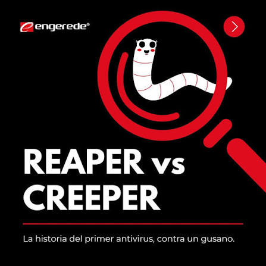

# **CIBERSEGURIDAD IT Y OT**
La ciberseguridad **nació en 1971 no para detener a grandes criminales**, sino como un curioso juego del gato y el ratón en los inicios de internet. Un investigador creó **"Creeper", el primer virus de la historia**, que saltaba entre computadoras dejando un simple mensaje: "Soy la enredadera, ¡atrápame si puedes!". En respuesta, otro programador inventó **"Reaper" (la segadora), el primer antivirus** diseñado exclusivamente para perseguir y borrar a Creeper de la red, dando inicio a la interminable batalla digital que hoy protege nuestro mundo.

 

## DEFINICIÓN
La ciberseguridad hace que todos los objetos como por ejemplo los que tenemos en casa como: moviles, ordenadores, y su informacion interna como las fotos, vídeos y cuentas bancarias se mantengan seguras. La ciberseguridad son las cerraduras, puertas de por medio, hueya dactilar, sensores y obstáculos para evitar que los ladrones accedan a esa información del usuario.

## **Tipos de CIBERSEGURIDAD**

|Tipo de Ciberseguridad|¿Qué protege exactamente?|Ejemplo práctico en el mundo real|
| - | - | - |
|**Seguridad de Red** |Defiende la infraestructura de red contra accesos no autorizados, interceptaciones e intrusos. |Configurar reglas en un firewall (como OPNsense) para bloquear conexiones sospechosas antes de que lleguen a tu equipo.|
|**Seguridad de Aplicaciones**|Asegura que el software y las páginas web estén libres de vulnerabilidades desde la fase de código.|Validar los datos de un formulario web escrito en PHP o Java para evitar que un atacante inyecte código malicioso.|
|**Seguridad de la Información**|Garantiza la privacidad e integridad de los datos puros, ya sea mientras se envían o mientras están guardados.|Encriptar las contraseñas de los usuarios dentro de una base de datos MySQL para que sean ilegibles si alguien las roba.|
|**Seguridad de Infraestructura**|Protege los sistemas operativos, servidores físicos y entornos virtualizados que mantienen los servicios funcionando.|Asignar correctamente los permisos de administrador y reglas de acceso en un entorno con Ubuntu Server o Windows Server.|
|**Seguridad Operativa**|Abarca los procesos y decisiones sobre cómo se manejan y protegen los datos en el día a día.|Crear una política que obligue a cambiar las contraseñas de acceso al panel de administración cada 90 días.|

### CARACTERÍSTICAS
- **`CONFIDENCIALIDAD`**
- **`Integridad`**
- **`Disponibilidad`**
- **`Autenticación`**
- **`No repudio`**

1. La **CONFIDENCIALIDAD** es la que se encarga de garantizar que la información solo llegue a la persona autorizada para tenerla.
    - **EJEMPLO**: que los datos personales de una base de datos de un hospital no los pueda ver otro usuario que no sea el propietario.

2. La **INTEGRIDAD** asegura que los datos no cambien o se rompan, siguiendo igual que como estaban al principio.
    - **EJEMPLO**: subir un archivo y guardarlo en una WEB, garantizando que ningun usuario que vea ese archivo pueda cambiar la información de este.

3. La **DISPONIBILIDAD**, los sistemas, aplicaciones y datos deben estar accesibles y funcionando siempre que los usuarios legítimos los necesiten.
    - **EJEMPLO**: Si pagas un mes de Claude Pro, la disponibilidad garantiza que puedas usar la IA 24/7 sin caídas. Si un ciberataque satura la red, los sistemas de seguridad bloquean el tráfico malicioso y reservan los servidores para los usuarios de pago, asegurando que tu servicio nunca deje de funcionar.

4. La **AUTENTICACIÓN**, es el proceso de verificar sin lugar a dudas que un usuario es quien dice ser.
    - **EJEMPLO**: Por ejemplo, exigir un usuario y contraseña antes de dar acceso a un panel de administración.

5. **NO REPUDIO**, Garantiza que nadie pueda negar haber realizado una acción en el sistema porque queda un rastro exacto de todo.
    - **EJEMPLO**: i un usuario borra un archivo importante en un servidor, el sistema guarda un registro (log) demostrando quién lo hizo y a qué hora, impidiendo que pueda negarlo.

## IT(Tecnología de la Información) Y OT(Tecnología de la Operación)

>La arquitectura de ciberseguridad IT/OT es el diseño de barreras y cortafuegos (firewalls) que se ponen entre ambos sistemas para garantizar que si un hacker logra entrar a la red IT (por ejemplo, a través de un correo trampa que abrió un empleado), no pueda "saltar" a la red OT y tomar el control físico de las máquinas de la fábrica.

*scaneo agresivo para detectar el sistema operativo y servicios activos*
```
nmap -A -T4 192.168.1.100 
```
### LA IA Y LA ACTUALIDAD
>La Inteligencia Artificial ha cambiado por completo las reglas del juego, actuando como un arma de doble filo. Por un lado, los ciberdelincuentes la utilizan para automatizar ataques, crear correos trampa (phishing) hiperrealistas y programar virus que mutan para no ser detectados. Por otro lado, los equipos de ciberseguridad usan la IA para analizar millones de datos de tráfico en tiempo real, detectando anomalías y bloqueando intrusos en milisegundos antes de que el ataque logre su objetivo.
### Las Consecuencias Reales: ¿Qué pasa cuando un ataque tiene éxito?
Un fallo en la seguridad tiene impactos drásticos dependiendo de dónde ocurra:

- En entornos IT (**Digital**): Provoca el secuestro de datos (Ransomware), extorsiones económicas, multas millonarias por vulnerar leyes de privacidad y la ruina de la reputación de una empresa.

- En entornos OT (**Físico**): Las consecuencias pueden ser catastróficas. Un hacker podría paralizar las cadenas de montaje de una fábrica, cortar el suministro eléctrico de una ciudad entera o alterar las válvulas en una planta potabilizadora de agua, poniendo en riesgo directo vidas humanas.
### Los Grandes Problemas: Sistemas Obsoletos en la Industria
Uno de los mayores retos en la industria son los **"sistemas heredados"** (legacy systems). Muchas fábricas e infraestructuras críticas siguen utilizando ordenadores y programas con décadas de antigüedad (como Windows XP) para controlar su maquinaria industrial. **El problema es que estos sistemas ya no reciben actualizaciones de seguridad**, pero las empresas no pueden detener la producción para cambiarlos sin perder millones. La única solución temporal suele ser aislarlos físicamente de internet.
### MÁS SOBRE CIBERSEGURIDAD 
####  [PÁGINA ESENCIAL SI QUIERES APRENDER MÁS SOBRE LA CIBERSEGURIDAD](https://www.welivesecurity.com/es/)
# ¿Crees que de verdad tus datos están a salvo?
